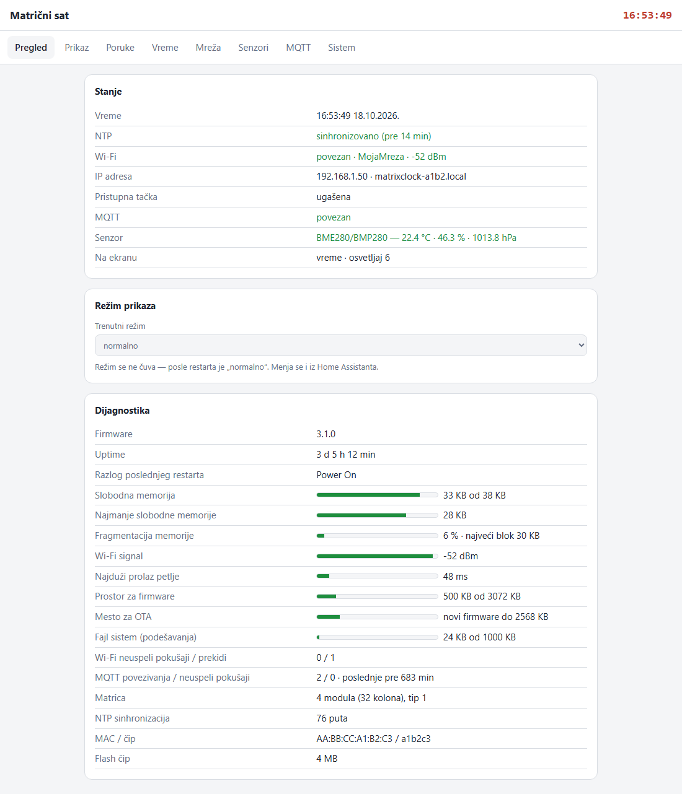
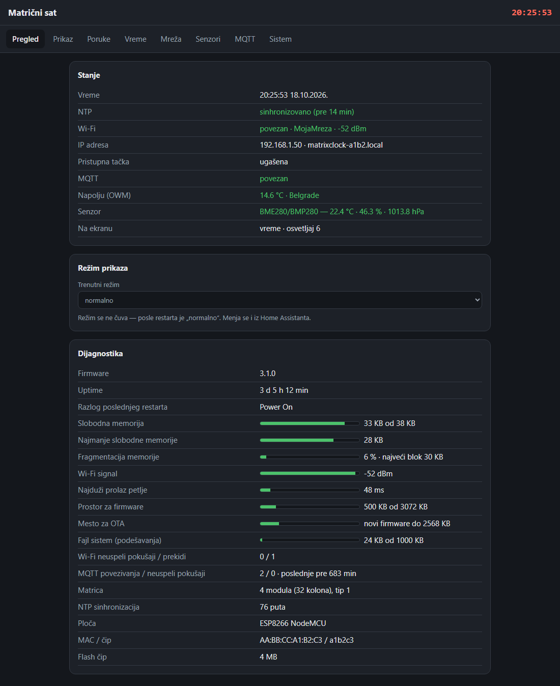
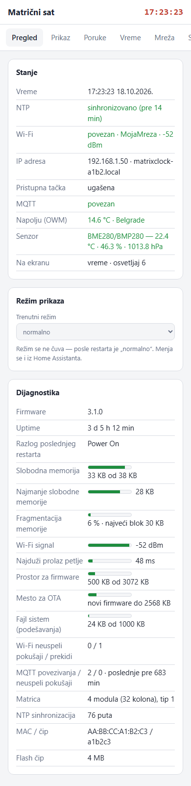
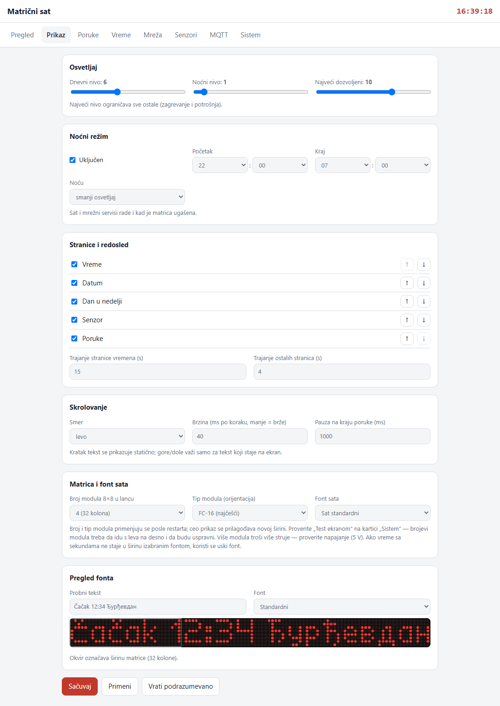
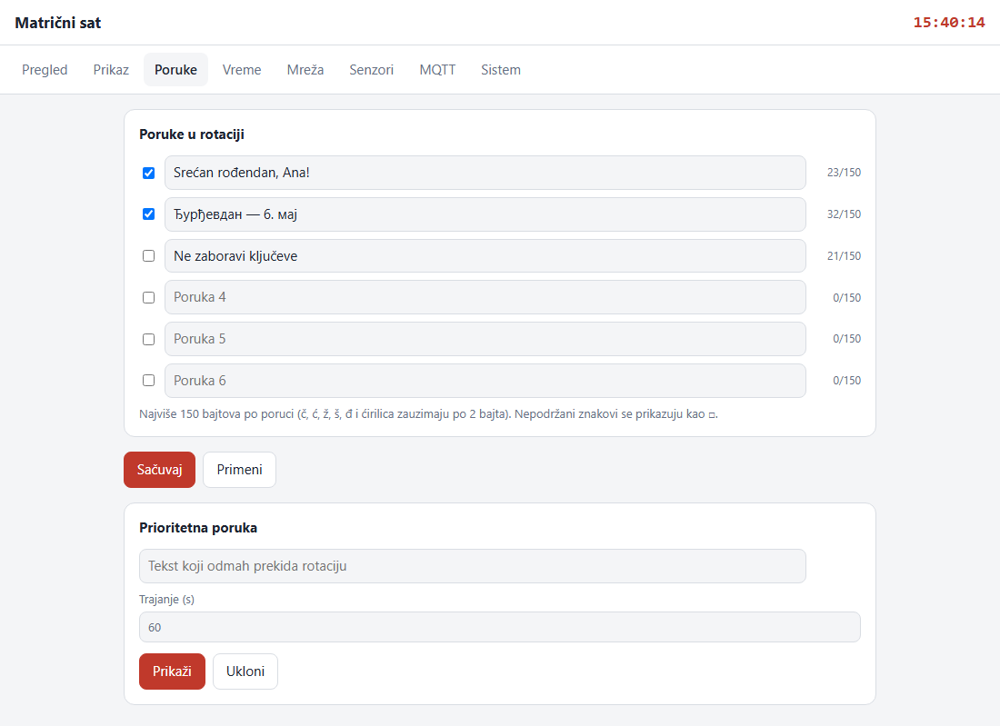
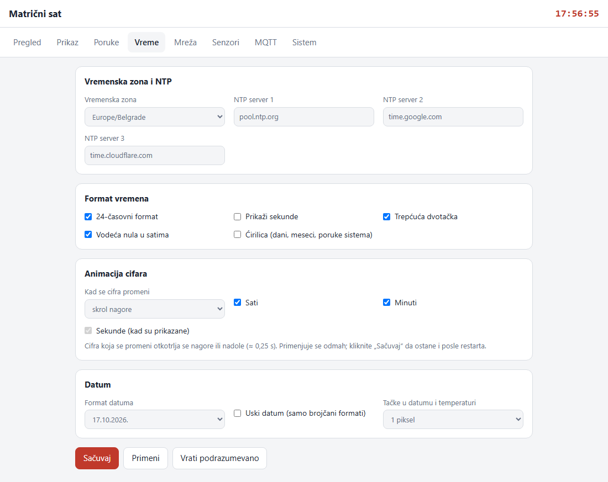
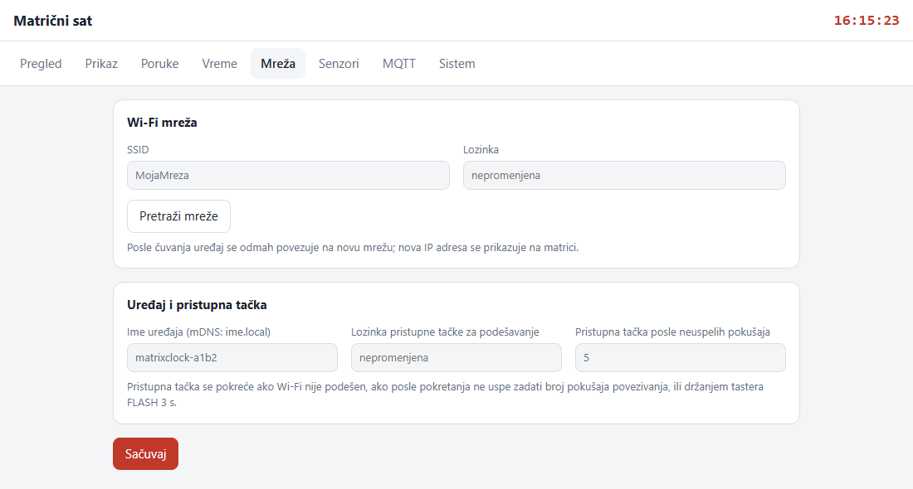
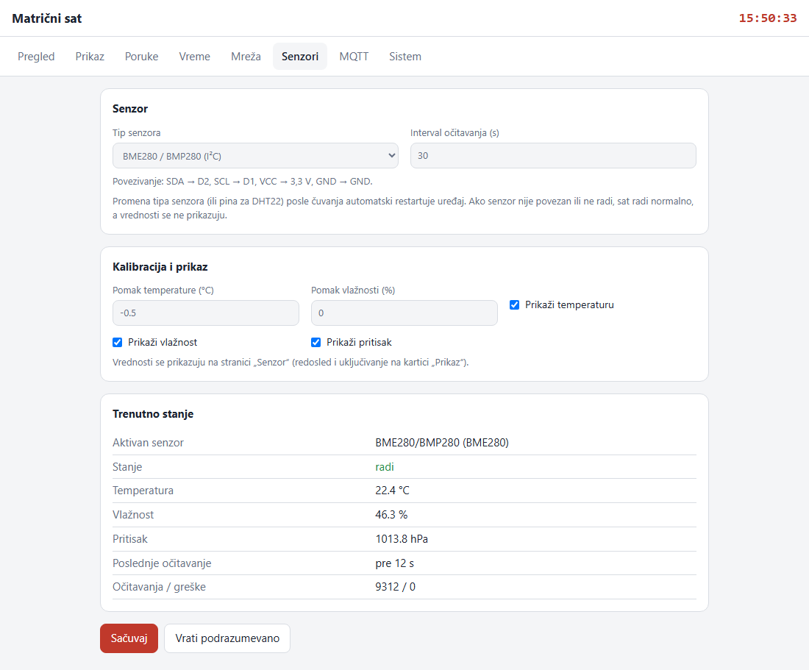
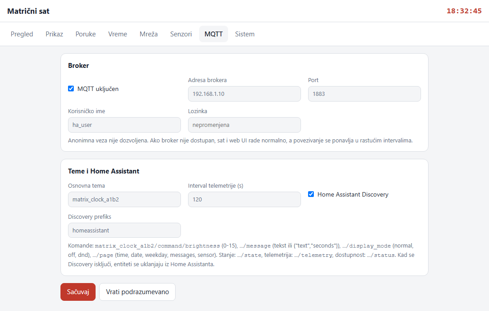
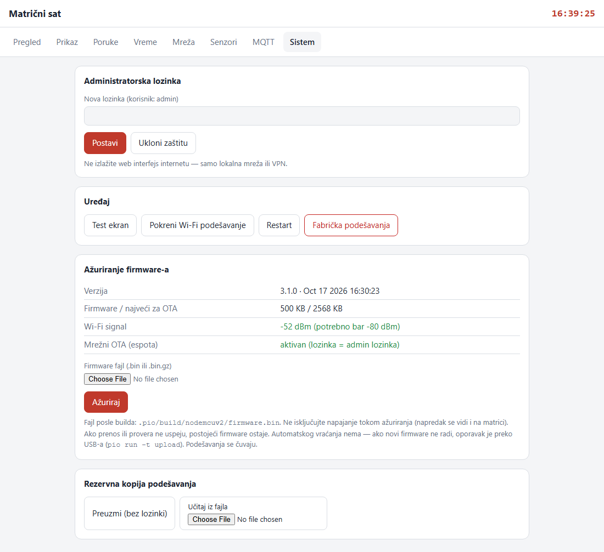

# NodeMCU ESP8266 LED matrični sat za Home Assistant

Matrični sat na ESP8266 (NodeMCU) sa MAX7219 LED matricom (3–16 modula 8×8, podrazumevano 8×32).
Prikazuje vreme, datum, dan u nedelji i poruke, ima lokalni web interfejs i opcionu MQTT integraciju
sa Home Assistantom. Ceo interfejs i prikaz su na srpskom, latinicom ili ćirilicom.

Osnovno pravilo dizajna: **sat ne zavisi od Wi-Fi-ja, MQTT-a, web UI-ja ni senzora**. Glavna petlja je
neblokirajuća, a kvar bilo kog podsistema ne zaustavlja prikaz vremena.

## Izgled web interfejsa

| Pregled (svetla tema) | Pregled (tamna tema) | Telefon |
|---|---|---|
|  |  |  |

<details>
<summary>Ostale kartice: Prikaz, Poruke, Vreme, Mreža, Senzori, MQTT, Sistem</summary>

| Prikaz | Poruke |
|---|---|
|  |  |
| **Vreme** | **Mreža** |
|  |  |
| **Senzori** | **MQTT** |
|  |  |
| **Sistem** | |
|  | |

</details>

Slike prikazuju izmišljene podatke. Prave se demo serverom koji ne zahteva uređaj: `python tools/mock_server.py` otvara UI na http://127.0.0.1:8080, a `python tools/screenshots.py` ponovo pravi slike pomoću headless Edge/Chrome-a.

## Mogućnosti

- **Vreme:** 12/24 h, opcione sekunde, trepćuća dvotačka, 3 fonta sata sa ciframa iste širine. NTP sa 3 servera, vremenska zona sa automatskim letnjim računanjem vremena. Bez mreže vreme nastavlja iz internog sata.
  - Izgled dvotačke se bira: 1+1, 2+2 ili 4+4 piksela.
  - Animacija cifara: cifra koja se promeni otkotrlja se nagore ili nadole. Sati, minuti i sekunde se biraju posebno.
  - Na 3 modula vreme se prikazuje uskim fontom, bez sekundi.
- **Datum:** 6 formata. Veličina tačaka u datumu i temperaturi se bira: 1, 2 ili 4 piksela. Brojčani datum može uskim ciframa.
- **Srpski tekst:** `č ć ž š đ` i ćirilica (UTF-8). Nazivi dana i meseci se biraju latinicom ili ćirilicom. Nepodržani znakovi se prikazuju kao □.
- **Prikaz:**
  - Rotacija stranica (vreme, datum, dan, poruke, senzor, napolju), sa podesivim redosledom i trajanjem.
  - Skrolovanje levo/desno/gore/dole. Kratak tekst stoji mirno.
  - Prioritetne poruke sa vremenom isteka.
  - Pri pokretanju jedan piksel obilazi obod matrice dok se vreme ne sinhronizuje.
- **Osvetljaj:** dnevni i noćni nivo, gornja granica, noćni režim (smanji ili ugasi) po rasporedu i režim „ne uznemiravaj“.
- **Wi-Fi:**
  - Pristupna tačka za podešavanje (captive portal) kad mreža nije podešena ili nije dostupna posle pokretanja, ili na taster FLASH (3 s).
  - Ponovno povezivanje u rastućim intervalima; mDNS `ime.local`.
- **Web UI:** kartice Pregled, Prikaz, Poruke, Vreme, Mreža, Senzori, MQTT i Sistem. Ima pregled fonta, dijagnostiku, admin lozinku i izvoz/uvoz podešavanja. Svi unosi se proveravaju na uređaju.
- **Senzori (opciono, jedan aktivan):** AHT20/AHT21, BME280/BMP280 (I²C) ili DHT22. Imaju kalibracioni pomak i sopstvene neblokirajuće drajvere. Neispravan ili odsutan senzor ne utiče na sat.
- **Spoljna temperatura (OpenWeatherMap):** stranica „Napolju“ sa izborom stavki: temperatura, oseća se, vlažnost, pritisak, brzina i pravac vetra i opis vremena. Detalji su u odeljku [Spoljna temperatura (OpenWeatherMap)](#spoljna-temperatura-openweathermap).
- **MQTT / Home Assistant:** asinhroni klijent (ne blokira sat), Discovery, availability, telemetrija i komande.
- **OTA ažuriranje:** iz web UI-ja ili preko `espota`, uz proveru signala, mesta i veličine fajla. Neuspelo ažuriranje ostavlja postojeći firmware.
- **Dijagnostika:** slobodna i najniža memorija, uptime, razlog restarta, najduža petlja, statusi Wi-Fi/NTP/MQTT.

## Hardver

| Funkcija | NodeMCU | GPIO |
|---|---|---|
| MAX7219 CLK | D5 | 14 |
| MAX7219 DIN | D7 | 13 |
| MAX7219 CS | D6 | 12 |
| I²C SDA (AHT2x, BME280) | D2 | 4 |
| I²C SCL (AHT2x, BME280) | D1 | 5 |
| DHT22 podaci (izbor u UI) | D0 / D1 / D2 | 16 / 5 / 4 |

- Matricu napajati sa **5 V** iz dovoljno jakog izvora, ne iz 3,3 V pina NodeMCU ploče. ESP i matrica moraju imati zajedničku masu.
- Za pouzdan rad preporučuje se pretvarač nivoa 3,3 V → 5 V za SPI linije (npr. 74HCT125).
- Orijentacija modula se bira u web UI-ju („Tip modula“) i proverava se „Test ekranom“.

## Build i flešovanje

Potreban je [PlatformIO](https://platformio.org/).

```
pio run                 # build
pio run -t upload       # flešovanje (port je u platformio.ini)
pio device monitor      # serijski monitor, 115200
```

Fontovi (`tools/fonts/*.txt` → `tools/gen_fonts.py`) i web UI (`web/index.html` → `tools/embed_web.py`)
generišu se automatski pri svakom buildu u `src/generated/`. Web UI je ugrađen u firmware, pa nije potreban
upload fajl sistema.

## Ažuriranje preko mreže (OTA)

- **Web UI:** kartica **Sistem → Ažuriranje firmware-a**, fajl `.pio/build/nodemcuv2/firmware.bin`. Napredak se prikazuje u pregledaču i na matrici.
- **PlatformIO (espota):** radi samo kad je postavljena admin lozinka, koja je i OTA lozinka:
  ```
  # PowerShell
  $env:MATRIX_OTA_PASS="admin-lozinka"; pio run -e ota -t upload
  ```
  Ime uređaja (`upload_port` u `[env:ota]`) prilagoditi svom uređaju ili navesti IP adresu.
- Ažuriranje ne počinje bez Wi-Fi veze, ako je signal slabiji od −80 dBm, ili ako nema dovoljno mesta. Prekinut, skraćen ili neispravan fajl se odbacuje, a postojeći firmware ostaje.
- **Automatskog vraćanja na stari firmware nema.** Ako novi firmware ne radi, oporavak je preko USB-a (`pio run -t upload`).

## Prvo pokretanje

1. Posle flešovanja sat pokreće Wi-Fi mrežu `MatrixClock-XXXX`, sa lozinkom `matrica123`. Ista uputstva skroluju na matrici.
2. Telefonom se poveži na tu mrežu i otvori `http://192.168.4.1`.
3. Na kartici **Mreža** izaberi kućnu mrežu, unesi lozinku i klikni **Sačuvaj**. Nova IP adresa se prikazuje na matrici.
4. Na kartici **Sistem** postavi administratorsku lozinku (korisnik `admin`) i promeni lozinku pristupne tačke.

Web interfejs je namenjen lokalnoj mreži; ne izlagati ga internetu.

## Spoljna temperatura (OpenWeatherMap)

Sat može da prikazuje vreme napolju sa [OpenWeatherMap](https://openweathermap.org/)-a. Koristi se API
„Current Weather“ (`/data/2.5/weather`), koji je dostupan uz besplatan nalog.

**Podešavanje:**

1. Napravi besplatan nalog na openweathermap.org i u odeljku **API keys** kopiraj ključ. Novi ključ proradi u roku od oko 2 sata. Do tada server vraća grešku „neispravan API ključ“.
2. U web UI-ju otvori karticu **Senzori → Spoljna temperatura (OpenWeatherMap)** i popuni polja:
   - **Uključeno**
   - **API ključ**: čuva se na satu kao lozinka, ne prikazuje se i ne izvozi u rezervnu kopiju.
   - **Grad**: naziv sa oznakom države (npr. `Beograd,RS`) ili **ID grada** (samo cifre, npr. `792453`). ID je pouzdaniji, a vidi se u adresi stranice grada na openweathermap.org.
   - **Osvežavanje**: 10–180 min, podrazumevano 15.
   - **Natpis na matrici**: podrazumevano „Napolju“. Ako je izabrana ćirilica, prikazuje se ćirilicom.
   - **Šta se prikazuje**, po checkbox za svaku stavku: temperatura, oseća se, vlažnost, pritisak, brzina vetra, pravac vetra, opis vremena.
3. Klikni **Sačuvaj**. Sat odmah šalje prvi zahtev, a rezultat se vidi u tabeli ispod podešavanja.
4. Na kartici **Prikaz → Stranice i redosled** uključi i rasporedi stranicu **„Napolju (OpenWeatherMap)“**.

**Na matrici** stranica „Napolju“ prikazuje natpis, pa izabrane stavke jednu za drugom:

| Stavka | Primer |
|---|---|
| natpis + temperatura | `Napolju 12.3°C`, ako staje zajedno; inače prvo `Napolju`, pa `12.3°C` |
| oseća se | `oseća se 10.2°C` |
| vlažnost | `72%` |
| pritisak | `1016 hPa` |
| vetar (pravac i brzina se biraju posebno) | `vetar SZ 3.1 m/s` (pravac: S, SI, I, JI, J, JZ, Z, SZ) |
| opis vremena | `slaba kiša` (server šalje opis na srpskom, a sat ga prikazuje izabranim pismom) |

Decimalna tačka prati izbor „Tačke u datumu i temperaturi“ na kartici Vreme. Ako vrednosti nema ili je
prestara (posle tri propuštena osvežavanja, a najmanje 1 h), stranica se preskače.

**Broj zahteva i besplatni limit:**

- Svaki sat šalje **najviše 1 zahtev u minuti**, bez obzira na razlog: raspored, dugme „Osveži sada“, promena podešavanja ili ponovni pokušaj posle greške. Raniji zahtev se odlaže, a ne odbacuje.
- Na 15 min to je 96 zahteva dnevno po satu, oko 2.900 mesečno. Besplatni plan za Current Weather dozvoljava 60 poziva u minuti i 1.000.000 mesečno ([cenovnik](https://openweathermap.org/full-price)), pa je i više satova sa istim ključem daleko ispod limita.
- Posle greške sat ponovo pokušava posle 5 minuta, ili posle intervala osvežavanja ako je kraći.
- Broj poslatih zahteva od pokretanja vidi se na kartici Senzori.

**Rad bez blokiranja i bezbednost:**

- Zahtev ide asinhrono (ESPAsyncTCP), pa sat ne staje dok čeka server.
- Greške su opisane u UI-ju: pogrešan ključ, grad nije pronađen, prekoračen limit, server ne odgovara.
- Zahtev ide preko **HTTP-a, ne HTTPS-a**. TLS na ESP8266 traži oko 20 KB RAM-a, koliko uz ostale funkcije nema. Zato ključ kroz mrežu putuje nešifrovano. Koristi poseban besplatan ključ samo za ovu namenu.

## MQTT teme

`<base>` je osnovna tema iz podešavanja (podrazumevano `matrix_clock_XXXX`).

| Tema | Smer | Sadržaj |
|---|---|---|
| `<base>/status` | sat → | `online` / `offline` (retained, LWT) |
| `<base>/state` | sat → | `{"brightness":4,"mode":"normal","on":true}` (retained) |
| `<base>/telemetry` | sat → | RSSI, uptime, memorija, NTP status, IP, verzija |
| `<base>/sensor` | sat → | `{"temperature":22.5,"humidity":45.0,"pressure":1013.2}` (retained, pri promeni) |
| `<base>/command/brightness` | → sat | `0`–`15` (važi do sledeće smene dan/noć) |
| `<base>/command/message` | → sat | tekst ili `{"text":"...","seconds":60}`; prazno = ukloni |
| `<base>/command/display_mode` | → sat | `normal`, `off`, `dnd` |
| `<base>/command/page` | → sat | `time`, `date`, `weekday`, `messages`, `sensor`, `weather` |
| `<base>/command/test`, `<base>/command/restart` | → sat | bilo koji sadržaj |

### Poruka iz Home Assistanta

Primer akcije u automatizaciji: poruka se odmah prikazuje i traje 120 s.

```yaml
actions:
  - action: mqtt.publish
    data:
      topic: matrix_clock_xxxx/command/message
      payload: '{"text":"Neko je na vratima!","seconds":120}'
```

Više primera ima u **[docs/home-assistant.md](docs/home-assistant.md)**: entitet „Poruka“,
skripta za višekratnu upotrebu, poruke iz šablona (temperatura, ime osobe), zvono na vratima,
veš mašina, otvoren prozor, otvorena vrata, detekcija dima, curenje vode, podsetnici, noćni režim, gašenje ekrana i izbor stranice.

## Serijska konzola (oporavak bez mreže)

Komande se kucaju na 115200 baud: `help`, `status`, `wifi <ssid>|<lozinka>`, `portal`, `msg <tekst>`, `test`, `restart`, `factory`.

## Napomena za Windows i CH340

Ako se serijski port otvori jednom, a zatim javlja grešku 31 („A device attached to the system is not functioning“),
vrati CH340 drajver na verziju 3.4.2014.8 u Device Manageru.

## Licenca

MIT — vidi [LICENSE](LICENSE).
